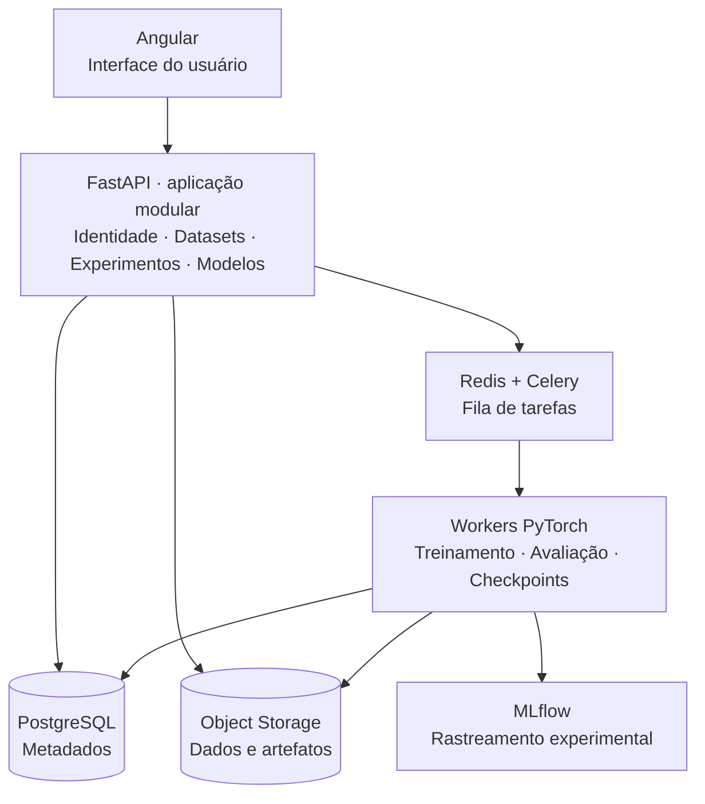
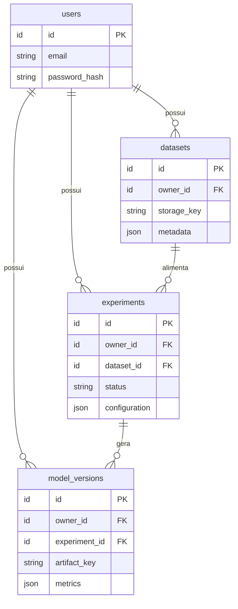
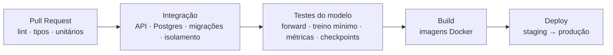

# AI Classifier Platform

Plataforma web multiusuário para **treinamento, avaliação, versionamento e uso de modelos de Deep Learning para classificação de imagens**.

Cada pessoa cria sua conta, envia seus próprios datasets, configura treinamentos, acompanha experimentos e utiliza os modelos resultantes, sem acesso aos recursos de outros usuários e sem precisar programar.

> **Status:** em fase de planejamento e fundação. Este README descreve a especificação e a arquitetura alvo; as seções marcadas como *planejado* ainda não estão implementadas.

---

## Sumário

- [Por que este projeto](#por-que-este-projeto)
- [Objetivos](#objetivos)
- [Escopo do MVP](#escopo-do-mvp)
- [Stack tecnológica](#stack-tecnológica)
- [Arquitetura](#arquitetura)
- [Estratégia de Deep Learning](#estratégia-de-deep-learning)
- [Protocolo de avaliação](#protocolo-de-avaliação)
- [Isolamento multiusuário e segurança](#isolamento-multiusuário-e-segurança)
- [CI/CD](#cicd)
- [Estrutura do repositório](#estrutura-do-repositório-planejada)
- [Como executar](#como-executar-planejado)
- [Roadmap](#roadmap)
- [Decisões e limitações](#decisões-e-limitações)

---

## Por que este projeto

A proposta vai além de uma CNN em um notebook. O objetivo é entregar um **sistema completo**: interface, API, persistência, filas, workers de treinamento, rastreamento de experimentos e automação de entrega. Ele também funciona como portfólio técnico em Deep Learning, engenharia de software, APIs, arquitetura, MLOps, CI/CD e segurança.

## Objetivos

1. Implementar modelos clássicos de classificação de imagens com **PyTorch**.
2. Treinar com datasets distintos por meio de um **pipeline configurável**.
3. Avaliar com **métricas e protocolos experimentalmente defensáveis**.
4. Oferecer uma **interface web** para datasets, treinamentos, experimentos e modelos.
5. Garantir o **isolamento dos recursos** de cada usuário.
6. Registrar configurações, métricas, versões e artefatos de cada experimento.
7. Automatizar testes, builds e implantação com **CI/CD**.

## Escopo do MVP

A primeira versão foca exclusivamente em **treinamento isolado por usuário**.

| Área | Funcionalidades |
|---|---|
| **Usuários** | Cadastro, autenticação, autorização e acesso restrito aos próprios recursos |
| **Datasets** | Upload de imagens, validação, identificação de classes, estatísticas e histórico |
| **Treinamento** | Escolha da arquitetura, hiperparâmetros, execução assíncrona e acompanhamento do progresso |
| **Avaliação** | Métricas, matriz de confusão, comparação de experimentos e análise de erros |
| **Modelos** | Versionamento de pesos, persistência de artefatos e inferência em imagens novas |

### Fora do MVP

- Treinamento colaborativo com dados de vários usuários
- Compartilhamento público de modelos
- Execução de código Python arbitrário enviado por usuários
- Orquestração distribuída complexa (Kubernetes)
- Treinamento de grandes modelos do zero
- Infraestrutura de GPU escalável sob demanda

Essas funcionalidades podem ser reavaliadas após a validação do núcleo da plataforma.

## Stack tecnológica

| Camada | Tecnologia | Responsabilidade |
|---|---|---|
| Frontend | Angular + TypeScript | Interface e gestão dos experimentos |
| Componentes visuais | Angular Material | Formulários, tabelas, diálogos e navegação |
| Gráficos | Apache ECharts ou Chart.js | Curvas de treinamento e métricas |
| API | FastAPI | Endpoints, validações e regras de negócio |
| Validação | Pydantic | Entradas e configurações |
| Persistência | PostgreSQL | Usuários, datasets, experimentos e metadados |
| ORM e migrações | SQLAlchemy + Alembic | Acesso ao banco e evolução do esquema |
| Deep Learning | PyTorch + Torchvision | Modelos, datasets e treinamento |
| Fila de tarefas | Celery + Redis | Agendamento e execução assíncrona |
| Armazenamento | Local (interface compatível com S3) | Imagens, checkpoints e artefatos |
| MLOps | MLflow | Rastreamento dos experimentos |
| Testes | Pytest e ferramentas de teste do Angular | Validação automatizada |
| Ambiente | Docker Compose | Execução reproduzível dos serviços |
| CI/CD | GitHub Actions | Testes, builds e implantação |

A combinação principal é **Angular + FastAPI + PyTorch**. MLflow e o processamento assíncrono podem ser introduzidos gradualmente.

## Arquitetura

Três abordagens complementares:

1. **Monólito modular:** o backend FastAPI é uma única aplicação organizada em módulos de negócio independentes (Identidade, Datasets, Experimentos, Modelos), com baixo custo operacional.
2. **Camadas com princípios de Clean Architecture:** regras de negócio não dependem do framework web, do banco nem da infraestrutura de treinamento, o que permite testar cada módulo isoladamente.
3. **Processamento assíncrono:** a API recebe e valida solicitações; workers separados executam treinamento e avaliação, sem bloquear requisições HTTP.



Microsserviços **não** fazem parte da primeira versão; a arquitetura só evoluirá para serviços independentes se houver necessidade real de escalar ou implantar componentes separadamente.

## Estratégia de Deep Learning

| Modelo | Papel | Descrição |
|---|---|---|
| **CNN própria** | Baseline | Rede convolucional em PyTorch para estabelecer referência e comparar desempenho |
| **ResNet-18** | Modelo principal | Arquitetura pré-treinada com a camada de classificação adaptada; suporta extração de características e fine-tuning |

### Datasets

1. **CIFAR-10:** primeiro benchmark e validação do pipeline.
2. **CIFAR-100:** avaliação com mais classes.
3. **Dataset externo de outro domínio** (ex.: espécies de plantas ou animais): teste de adaptação.

Os datasets entram por **adaptadores padronizados**, de modo que o núcleo de treinamento não precise mudar a cada novo conjunto. A adaptação inclui validação de arquivos, mapeamento de classes, pré-processamento, divisão dos dados e configuração do modelo.

## Protocolo de avaliação

Métricas e experimentos são definidos **antes** de selecionar o melhor modelo, para evitar uma busca pelo "número mais bonito".

| Métrica | Finalidade |
|---|---|
| Accuracy | Desempenho geral |
| Macro F1 | Desempenho médio entre as classes |
| Balanced accuracy | Recall médio por classe |
| Precision e recall por classe | Falsos positivos e negativos |
| Matriz de confusão | Identificação dos erros |
| Cross-entropy / loss | Monitoramento da otimização |
| Tempo de treino e latência | Eficiência computacional |
| Memória e parâmetros | Custo do modelo |

### Regras experimentais

- Separar treino, validação e teste.
- Evitar vazamento de dados e imagens duplicadas entre partições.
- Manter o conjunto de teste fora da seleção de hiperparâmetros.
- Registrar sementes, versões de bibliotecas, configurações e identificadores dos datasets.
- Repetir com diferentes sementes quando apropriado e reportar média, variabilidade e intervalos de confiança.
- Comparar sempre com baselines.
- Avaliar a calibração das probabilidades se a interface exibir estimativas de confiança.

O objetivo é produzir resultados **reproduzíveis**, não prometer uma acurácia arbitrária antes de executar os experimentos.

## Isolamento multiusuário e segurança

Cada usuário acessa apenas seus próprios datasets, experimentos e modelos.



**Requisitos obrigatórios**

- Autenticação e autorização no backend
- Verificação de propriedade em **todas** as operações sobre recursos
- Armazenamento isolado por usuário
- Limites de upload, duração de jobs e consumo de recursos
- Validação dos arquivos enviados
- Proteção de segredos e credenciais
- Registro de falhas e operações relevantes
- Testes automatizados contra acesso cruzado entre usuários
- O **worker** também valida a associação usuário ↔ experimento ↔ dataset antes de treinar

## CI/CD



O treinamento completo dos modelos fica **fora do CI convencional**: os testes usam dados pequenos e CPU. Experimentos caros rodam separadamente, com rastreamento no MLflow.

## Estrutura do repositório (planejada)

```
ai-classifier-platform/
├── backend/            # FastAPI: módulos identity, datasets, experiments, models
│   ├── app/
│   ├── migrations/     # Alembic
│   └── tests/
├── ml/                 # Biblioteca de treino/avaliação (PyTorch), testável sem a API
├── worker/             # Tarefas Celery
├── frontend/           # Angular
├── infra/              # Docker Compose, configs de deploy
├── docs/               # ADRs, contrato OpenAPI, protocolo experimental
└── .github/workflows/  # CI/CD
```

## Como executar (planejado)

```bash
# Subir todos os serviços (API, worker, Postgres, Redis, MLflow, frontend)
docker compose up --build

# Backend: testes
cd backend && pytest

# Frontend: testes
cd frontend && npm test
```

> Os comandos acima serão validados e detalhados à medida que a Fase 1 for concluída.

## Roadmap

| Fase | Tema | Entrega |
|---|---|---|
| **1** | Fundação | Repositório, ambiente, configuração, testes iniciais e CI |
| **2** | Backend | Usuários, PostgreSQL, migrações, autenticação e testes de isolamento |
| **3** | ML | CNN e ResNet-18, benchmarks, avaliação científica e persistência de artefatos |
| **4** | Integração | Fila, workers, estados dos experimentos, logs e progresso |
| **5** | Frontend | Telas de datasets, treinamento, experimentos, avaliação e inferência |
| **6** | Entrega | CI/CD completo, testes de segurança, armazenamento persistente e publicação |

Princípios transversais: fatias verticais de entrega, testes e CI desde o início, contrato OpenAPI como fonte de verdade para front e back, e segurança incremental (a Fase 6 audita, não introduz).

## Decisões e limitações

- **Adaptável não é universal:** ao mudar classes ou domínio, é preciso retreinar ou ajustar o modelo e medir o desempenho no novo contexto.
- **Sem acurácia prometida:** os resultados serão reportados somente após a execução do protocolo.
- **Sem microsserviços nem Kubernetes** na v1.
- **Frontend em Angular**; React não será utilizado nesta proposta.

---

Projeto em desenvolvimento. Contribuições e sugestões serão bem-vindas após a conclusão da fundação (Fase 1).
